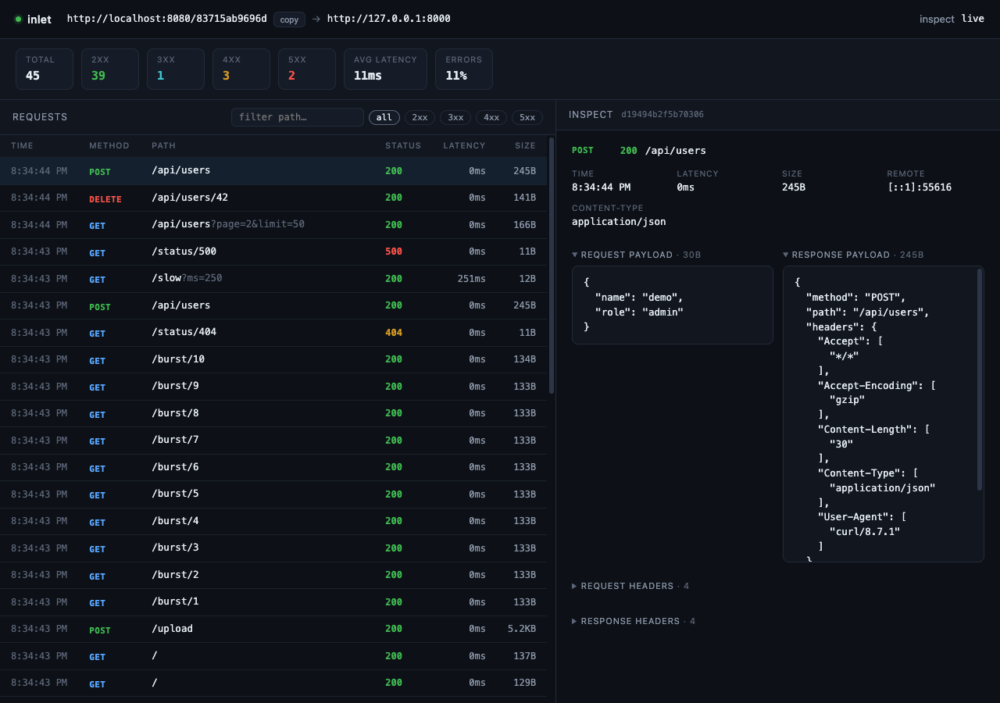

# inlet

**Your localhost, now a URL.**

Share a local HTTP app with a stable public link. No port forwarding, router
changes, or deployment required.


```sh
inlet signup
inlet http 3000
```

Get a client from [GitHub Releases](#install-the-client), or jump to the
[local server setup](#quick-start-local).

Start your local app on port `3000` before opening the tunnel.

## How it works

```
browser ──► https://tunnel.example.com/<tunnel-id>/...
                              │
                        inletd server :8080
                              │
                        inlet client ──► http://127.0.0.1:3000
```

The client keeps one WebSocket connection to the server. Requests to the
tunnel's public URL travel through it to your local app; the first URL path
segment identifies the tunnel.

The terminal shows connection status and recent requests. The local inspector
(`http://127.0.0.1:4040`) keeps the last 200 requests, including headers,
bodies, and timings:



## Requirements

- Go 1.23+ (no CGO; `gorilla/websocket` + `modernc.org/sqlite`)
- Docker + Compose (optional, for deployment)

## Install the client

Download the client archive for your OS and CPU from
[GitHub Releases](https://github.com/ynui/inlet/releases/latest). Extract it and
put the `inlet` binary somewhere on your `PATH`. Releases include Linux and
macOS builds for amd64/arm64 and Windows amd64 builds; archives include
`inlet`, `inletd`, and `inlet-admin`, with checksums in the versioned checksum
file. On macOS or Linux, you can install the client with Homebrew:

```bash
brew tap ynui/tap
brew install inlet
```

You do not need Go installed to use a release binary.

Release client binaries default to the hosted service at
`wss://inletd.onrender.com`. Builds from source default to
`ws://localhost:8080` for local development. Set another server at any time
with `inlet config set-server <url>`.

The public demo allows open signup: install a release client and run
`inlet signup` without an invite or server flag. Source builds continue to use
localhost unless you set the server with `inlet config set-server`.

To build from source instead, clone the repository and run `make build`.
This also builds `./inlet-admin` for remote server administration.

## Quick start (local)

```bash
make build         # produces ./inlet, ./inletd, and ./inlet-admin
```

All state lives in one local SQLite DB (`./data/inlet.db`, in the directory you start
`inletd` from). Admin commands (`invite`, `token`) write to that DB directly —
run them from that same directory, with the server stopped or running.

### 1. Create an invite (or a token)

```bash
./inletd invite create --ttl 24h --label me   # prints a one-time code
./inletd token create --label me              # alternative: token straight away
```

Invites are hashed, single-use, and expire. The code is only printed once.
`--ttl` defaults to `INLET_INVITE_TTL` (`24h`).

### 2. Start the server

```bash
INLET_PUBLIC_BASE=http://localhost:8080 ./inletd
# public, control, and signup on :8080
```

`INLET_PUBLIC_BASE` is the public URL clients print. Set it to the HTTPS
hostname served by your reverse proxy. Without it, the server derives the URL
from the control request and forwarded headers.

When using the hosted Render service, free instances may sleep after inactivity
and their local filesystem is ephemeral. Since inlet stores tokens and tunnel
IDs in SQLite, use durable storage or back up the database before relying on
that service for persistent accounts.

Invite-only is the default. For open signup:

```bash
INLET_OPEN_SIGNUP=true ./inletd
```

The server loads `./.env` from its working directory. Keep
`INLET_OPEN_SIGNUP=false` (or unset) for invite-only signup.

### 3. Claim the invite on the client

```bash
./inlet signup --invite <code>     # saves the token to ~/.config/inlet/config.json
./inlet signup --server ws://localhost:8080 --invite <code>   # explicit server
./inlet signup                     # open signup only (no --invite)
```

Source builds default to `ws://localhost:8080`; release binaries default to
`wss://inletd.onrender.com`. Pass `--server` to override the default. Trying to
reuse an invite fails with `403 invalid or expired invite`.

After a successful claim, the client confirms that the token was saved, shows
the selected server and public URL, and prints `inlet http <local-port>` as the
next step. The token itself is not printed. The server URL is saved with the
token, so future `inlet http` runs use the same server automatically.

Example:

```text
invite claimed successfully
token saved to: ~/.config/inlet/config.json
server: wss://tunnel.example.com
public url: https://tunnel.example.com/<tunnel-id>
run: inlet http <local-port>
```

### 4. Tunnel something

```bash
go run ./scripts/demo-server       # test target on :8000, in another shell
./inlet http 8000                  # prints the public URL
```

### 5. Hit it

```bash
curl http://localhost:8080/<id>/   # <id> from the printed URL
open http://127.0.0.1:4040         # local inspector, last 200 requests
```

Manage tokens/invites while it runs:

```bash
./inletd token list                # prefix, source, tunnel ID, last used, state
./inletd token revoke <prefix>
./inletd invite create --ttl 1h
```

`make dev` / `scripts/dev.sh start` does steps 1–2 for you (builds, creates a
`dev` and `dev-admin` tokens, configures local client/admin credentials, and
starts `inletd` + the demo server); then run `./inlet http 8000` and stop with
`make dev-stop`.

The same tunnel ID is reused on every reconnect for that token. `--new-url` on
`inlet http` rotates it.

## Client

```bash
inlet signup --server ws://localhost:8080  # open signup, or --invite <code>
inlet config set-server wss://tunnel.example.com
inlet config show                          # token value is hidden
inlet doctor [--port 3000]                 # check server and optional local app
inlet auth <token>                         # save an existing token
inlet token list                           # list this token and open-signup tokens for this signup IP
inlet token label <prefix> "work laptop"   # rename a listed token
inlet token revoke <prefix>                # revoke a listed token
inlet http <port>                         # tunnel a local HTTP server
inlet http <port> --new-url                # rotate the tunnel ID
inlet http <port> --inspect 4041           # inspector port (default 4040)
```

`inlet token list` always shows the current token, plus open-signup tokens
associated with its signup IP. Since open-signup limits are also per IP, users
sharing that public IP can see and manage those open-signup tokens. Labels can
be up to 64 characters; use `""` to clear one.

Flags work before or after the port. While running, the terminal shows a live
status pane (last 10 requests, connection status and errors, 2xx–5xx counts).
`Ctrl-C` exits and restores the terminal. The inspector at
`http://127.0.0.1:<inspectPort>` keeps the last 200
requests and is bound to loopback only.

The server URL is saved in the client config. `inlet signup --server …` sets
it during signup, or change it later with `inlet config set-server <url>`.
`inlet auth` and `inlet http` use the saved URL:

```json
// ~/.config/inlet/config.json
{ "server": "wss://inletd.onrender.com", "token": "…", "inspectPort": 4040 }
```

Use `ws://` for a local HTTP server and `wss://` for a TLS reverse proxy. If the
URL has no path, the client appends `/_inlet/control` automatically.
`inlet config set-server https://tunnel.example.com` is also accepted and saved
as `wss://tunnel.example.com`.

## Server

```bash
inletd [-bind :8080] [-control <addr>]
```

By default, public tunnel traffic, the WebSocket control channel, and signup
share the listener at `:8080`. Set `-control :8081` (or
`INLET_CONTROL_ADDR=:8081`) to run control and signup on a separate listener.

Configuration precedence: flag defaults → `~/.config/inlet/server.json` →
explicit CLI flags → environment. An open-signup value changed with
`inlet-admin` is stored in SQLite and takes precedence over startup config after
the first remote change.

| Env | Meaning | Default |
| --- | --- | --- |
| `INLET_BIND` | public HTTP listener | `:8080` |
| `INLET_CONTROL_ADDR` | optional separate control/signup listener | unset (shares `INLET_BIND`) |
| `INLET_PUBLIC_BASE` | public base URL advertised to clients (e.g. `https://example.com`) | derived from control request |
| `INLET_OPEN_SIGNUP` | allow token creation without an invite | `false` |
| `INLET_ADMIN_TOKEN` | bootstrap a remote admin token; stored hashed in SQLite | unset |
| `INLET_ACCESS_LOG` | log public request method, tunnel ID, status and duration | `false` |
| `INLET_DB` | SQLite database path | `./data/inlet.db` |
| `INLET_STALE_AFTER` | delete inactive invite/admin tokens after | `720h` |
| `INLET_OPEN_STALE_AFTER` | delete inactive open-signup tokens after | `168h` |
| `INLET_REVOKED_RETENTION` | keep revoked tokens before deleting | `168h` |
| `INLET_INVITE_TTL` | default invite lifetime | `24h` |

Environment values override `server.json` at startup. After a remote
`inlet-admin` change, the persisted open-signup setting overrides both. The
server also loads `./.env` at startup without overwriting variables that are already exported, so
`make run-server` works after `cp .env.example .env`.
Lifecycle and error logs are always enabled. Set `INLET_ACCESS_LOG=true` to log
successful public requests too; access logs omit paths, query strings, headers,
bodies and client addresses.

### Remote administration

Bootstrap an admin token without opening a server shell by setting a random
`INLET_ADMIN_TOKEN` secret in the deployment environment, then redeploying.
The server stores only its hash in SQLite. Alternatively, create one locally:

```bash
inletd token create --label remote-admin
```

Install `inlet-admin` from the matching release archive on your workstation,
then save the token and server URL. Use the HTTPS URL for remote administration:

```bash
inlet-admin auth --server https://tunnel.example.com <admin-token>
inlet-admin invite create --ttl 24h --label teammate
inlet-admin config show
inlet-admin config set open-signup true
inlet-admin token list --limit 50 --offset 0
inlet-admin token create --label laptop
inlet-admin token label <prefix> "work laptop"
inlet-admin token revoke <prefix> [<prefix> ...]
```

The admin token is stored separately in `~/.config/inlet/admin.json`; the
regular `inlet` client never reads or sends it. Remote admin requests accept
only tokens created as admin tokens and require HTTPS, except for loopback
development. The signup setting persists in SQLite. Set `INLET_OPEN_SIGNUP` or
`server.json` to choose its initial value; once changed remotely, the saved
admin setting wins after restarts.

Token listings show metadata and prefixes only. `token create` prints a new
client token once; use `token create --admin` only when provisioning another
remote administrator. Revoke one or more prefixes in a single transaction.
Revoking the admin token used for the request is blocked to prevent accidental
lockout; authenticate with another admin token first.

`server.json` mirrors these keys. For example:
`{"bind": ":8080", "controlAddr": "", "publicBase": "…", "openSignup": false}`.
Set `controlAddr` to an address such as `:8081` to enable a separate control
listener. A legacy non-empty `controlAddr` keeps that listener enabled; startup
logs a warning. Clear it with `-control=` or `INLET_CONTROL_ADDR=` to return to
one listener.

Tokens are stored as SHA-256 hashes in SQLite, and each token row owns its tunnel
ID. Create client tokens with `inletd token create`, claim an invite, or use
`inlet-admin` to manage tokens remotely.

Admin commands run against the local DB:

```bash
inletd token create --label laptop   # print a token once
inletd token list
inletd token revoke <prefix>
inletd invite create --ttl 24h
inletd doctor                         # check a running server's health endpoint
```

A janitor removes expired invites and stale tokens hourly. Tokens with an active
connection are skipped. Revocation applies to new connections immediately; an
already-connected client keeps its session until it reconnects.

## Docker

```bash
cp .env.example .env       # set INLET_PUBLIC_BASE to your public HTTPS hostname
docker compose up -d --build
docker compose exec inletd inletd invite create --label client
```

Copy the one-time invite code, then claim it on the client:

```bash
inlet signup --server wss://tunnel.example.com --invite <invite-code>
```

For an administrator token without an invite, use
`docker compose exec inletd inletd token create --label admin`.

The container listens on `8080` for public, control, and signup traffic. The
host port defaults to `8080`; set `INLET_HOST_PORT=9900` in `.env` if another
service already uses it. Compose includes a health check at
`/_inlet/healthz`; run `docker compose ps` to see the health state or
`docker compose exec inletd inletd doctor` for a direct check. The database is
kept in `./data/inlet.db` (mounted as `/data`, `INLET_DB=/data/inlet.db`) so tokens and
tunnel IDs survive restarts. `.env` and `data/` are gitignored — don't commit
real tokens.

For production, terminate TLS in Nginx and proxy all paths to inlet's single
listener. Example `inlet.conf` (adjust the hostname, certificate paths, and
backend address for your setup):

```nginx
server {
    listen 80;
    listen [::]:80;
    listen 443 ssl;
    listen [::]:443 ssl;

    server_name tunnel.example.com;

    ssl_certificate /etc/letsencrypt/live/example.com/fullchain.pem;
    ssl_certificate_key /etc/letsencrypt/live/example.com/privkey.pem;

    include /etc/nginx/snippets/ssl-params.conf;
    include /etc/nginx/snippets/force-ssl.conf;
    include /etc/nginx/snippets/hsts-header.conf;

    access_log /var/log/nginx/access.log main_ext;

    location / {
        proxy_pass http://192.168.1.1:8080;
        proxy_http_version 1.1;
        proxy_set_header Host $host;
        proxy_set_header X-Real-IP $remote_addr;
        proxy_set_header X-Forwarded-For $proxy_add_x_forwarded_for;
        proxy_set_header X-Forwarded-Proto $scheme;
        proxy_set_header X-Forwarded-Host $host;
        proxy_set_header Upgrade $http_upgrade;
        proxy_set_header Connection $connection_upgrade;
    }
}
```

This uses the `$connection_upgrade` variable commonly defined in Nginx's `http`
block. Set `INLET_PUBLIC_BASE=https://tunnel.example.com` and point clients at
`wss://tunnel.example.com/_inlet/control`. If Nginx runs in the same Compose
network, use `proxy_pass http://inletd:8080;` and remove the Compose `ports:`
mapping if the backend should not be reachable directly from the host.
If you set `INLET_HOST_PORT=9900`, set the host-based Nginx upstream to
`http://192.168.1.1:9900` as well.

For an existing deployment with a separate control listener, set
`INLET_CONTROL_ADDR=:8081`, publish that port, and route `/_inlet/control`,
`/_inlet/signup`, `/_inlet/admin/`, and `/_inlet/tokens` to `8081`; keep public
tunnel paths on `8080`.

To upgrade a source checkout, pull the new version and run
`docker compose up -d --build`. Back up the SQLite database with a brief
downtime so its WAL files are included:

```bash
docker compose stop inletd
tar -czf inlet-data-backup.tgz data
docker compose start inletd
```

## Development

```bash
go test ./...                              # all tests
go test ./cmd/client -run TestParseHTTPArgs
go vet ./...
make build-all                             # linux/amd64 + darwin/arm64 into dist/
```

Manual end-to-end check (after `inlet signup` or `inlet auth` from Quick start):

```bash
go run ./scripts/demo-server               # test target on :8000
./inlet http 8000                          # in another shell
scripts/demo-requests.sh                   # or: scripts/demo-requests.sh http://localhost:8080/<id>
```

`scripts/demo-server` fakes statuses, redirects, slow responses, sizes, and
echoes request details. `scripts/demo-requests.sh` drives the CLI pane and
inspector with varied methods, user agents, and payloads.

Regenerate the README screenshot (`docs/screenshots/cli.gif`) with:

```bash
source scripts/demo/setup.sh               # start servers + schedule requests
vhs scripts/demo/demo.tape                # records docs/screenshots/cli.gif
```

## Limitations

- HTTP only. There is no WebSocket upgrade support; the proxy forwards plain HTTP
  requests and strips `Connection`/`Upgrade`.
- No built-in TLS. Terminate TLS at a reverse proxy in front of inlet.
- The inspector listens on loopback only and keeps the last 200 requests in memory.
- HTTP request/response bodies are streamed in chunks over the control
  WebSocket, so large payloads no longer kill the connection. Individual
  control messages remain capped at 512 KiB.
- Set `INLET_PUBLIC_BASE` for the exact public URL. Otherwise the server
  derives one from the control request and honors `X-Forwarded-Proto` /
  `X-Forwarded-Host`. When a forwarded proto is present, the proxy's host is
  treated as the public host without adding inlet's internal listen port.
- The control WebSocket rejects cross-origin browser requests. Open signup is
  rate limited per IP (5 attempts/hour, 3 unrevoked open tokens/IP); control
  connections are not. Tokens are long-lived bearer credentials; terminate TLS
  at a reverse proxy and keep the backend listener private where possible.

## License

[MIT](LICENSE)
